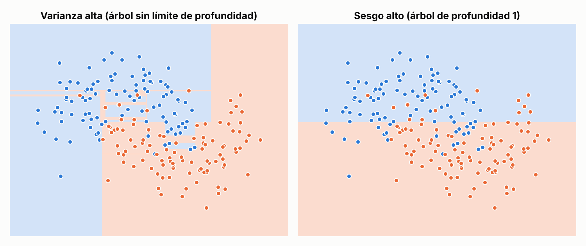
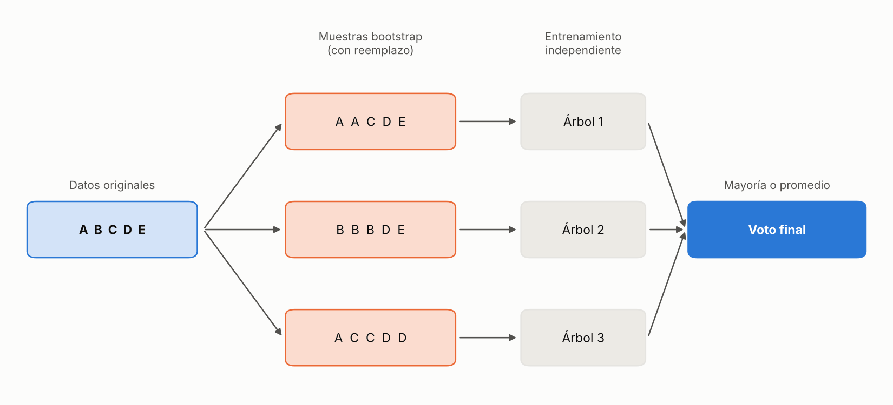
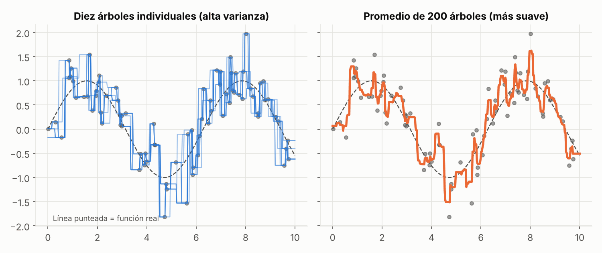
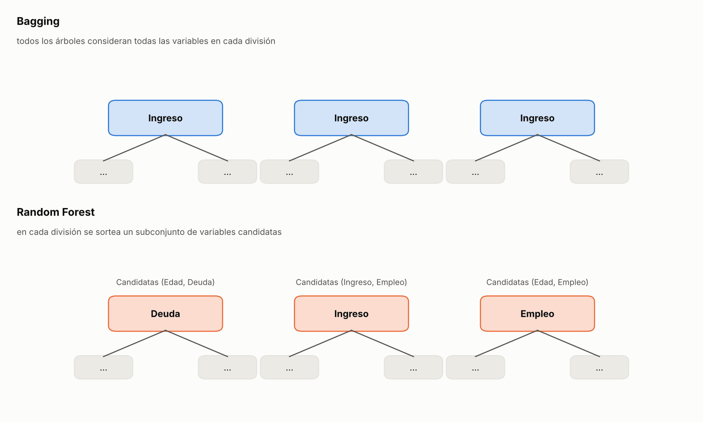
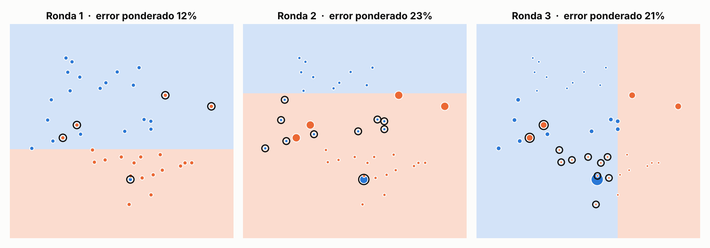
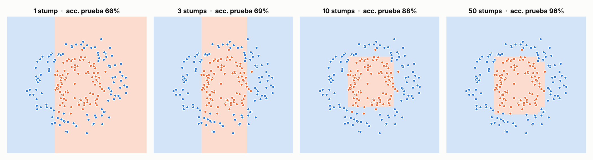
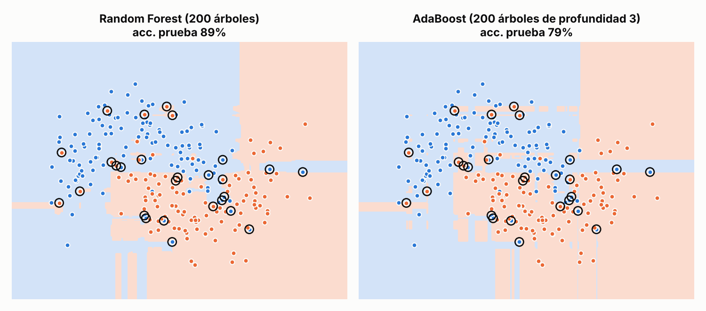

**Bagging y boosting combinan modelos de formas distintas porque resuelven problemas distintos**

Las **técnicas de ensamble** (*ensemble learning*) combinan las predicciones de varios modelos para obtener un resultado más preciso y estable que el de cualquiera de ellos por separado. Entre las estrategias disponibles, dos familias han tenido una influencia especial en la práctica de la ciencia de datos: **bagging** y **boosting**, representadas aquí por dos algoritmos de referencia, **Random Forest** y **AdaBoost**.

Aunque ambas familias combinan muchos modelos, no resuelven el mismo problema. Bagging reduce la inestabilidad de modelos que cambian demasiado ante pequeñas variaciones en los datos; boosting mejora modelos que son demasiado simples para capturar el patrón. Este artículo explica cada enfoque con matemática mínima, apoyándose en gráficas, y sitúa a cada técnica en el trabajo que le dio origen.

---

## 1. Sesgo y varianza

Un modelo individual puede fallar por dos motivos opuestos:

- **Varianza alta.** El modelo es tan sensible a los datos de entrenamiento que pequeños cambios en ellos producen predictores muy distintos. Es el sobreajuste (*overfitting*).
- **Sesgo alto.** El modelo es tan simple que no logra representar la estructura de los datos. Es el subajuste (*underfitting*).

Estos conceptos se ilustran bien con árboles de decisión, el modelo base más habitual en los ensambles. La **profundidad** de un árbol es el número de preguntas sucesivas (niveles de división) que puede encadenar antes de emitir una predicción. Un árbol de profundidad 1, llamado *stump*, realiza una sola pregunta. Un árbol sin límite de profundidad continúa dividiendo los datos hasta ajustarse casi por completo a los ejemplos de entrenamiento, incluido su ruido.

*Dos formas de error con los mismos datos. A la izquierda, un árbol sin límite de profundidad sigue cada punto de entrenamiento y produce una frontera irregular (varianza alta). A la derecha, un árbol de profundidad 1 traza una única división que ignora la forma de los datos (sesgo alto).*

Cada familia de ensambles se orienta a uno de estos problemas: bagging a la varianza y boosting al sesgo. Esa diferencia organiza el resto del artículo.

---

## 2. Bagging

### 2.1 Intuición

El punto de partida es un principio estadístico conocido: el promedio de varias estimaciones independientes, cada una con errores propios, suele ser más preciso que una estimación individual, porque los errores aleatorios tienden a compensarse. Bagging traslada este principio al aprendizaje automático: entrena varios modelos sobre versiones distintas de los datos y combina sus predicciones.

### 2.2 Artículo seminal

Bagging fue propuesto por Leo Breiman en *Bagging Predictors* (*Machine Learning*, 1996). El artículo combina dos elementos: el **bootstrap**, una técnica de remuestreo con reemplazo asociada a Bradley Efron, y la **agregación** de predicciones, mediante voto en clasificación y promedio en regresión. Breiman evaluó el método con árboles de clasificación y de regresión, y con selección de subconjuntos de variables en regresión lineal, y observó mejoras sustanciales de precisión.

Su conclusión más influyente es que el beneficio depende de la **inestabilidad** del método base: si perturbar el conjunto de entrenamiento cambia de forma significativa el predictor obtenido, bagging puede mejorar la precisión. Ese criterio explica por qué la técnica se aplica sobre todo a árboles de decisión con mucha profundidad, y por qué aporta poco a modelos ya estables.

### 2.3 Funcionamiento

1. **Remuestreo (bootstrap).** A partir del conjunto original se generan muchas muestras aleatorias con reemplazo. Cada muestra tiene el mismo tamaño que el original, pero algunas observaciones aparecen repetidas y otras no aparecen (aproximadamente el 37% queda fuera de cada muestra).
2. **Entrenamiento independiente.** Cada muestra se usa para entrenar un modelo, sin relación con los demás.
3. **Agregación.** Las predicciones se combinan por mayoría en clasificación o por promedio en regresión.

Los datos no se modifican en ningún momento. La diversidad entre modelos proviene únicamente de *qué observaciones recibe cada uno y cuántas veces*.

*Esquema de bagging. Cada muestra bootstrap entrena un modelo independiente y la decisión final surge de la combinación de todos.*

### 2.4 Problema que resuelve

Bagging reduce la **varianza**. No mejora cada modelo individual, sino la estabilidad del conjunto: los árboles con mucha profundidad son erráticos por separado, pero sus errores aleatorios se compensan al promediarlos.

*A la izquierda, diez árboles entrenados con muestras bootstrap distintas: cada uno se ajusta de forma diferente al ruido. A la derecha, el promedio de 200 árboles produce una curva más suave y más cercana a la función real (línea punteada). Sigue sin ser perfecta, porque bagging reduce la varianza pero no la elimina.*

---

## 3. Random Forest

### 3.1 Limitación del bagging

Bagging tiene un punto débil. Si existe una variable muy dominante (por ejemplo, el ingreso al predecir si un cliente pagará un crédito), casi todos los árboles la elegirán como primera división, aunque cada uno reciba una muestra bootstrap diferente. Los árboles resultan muy parecidos, sus errores quedan correlacionados y el promedio aporta menos de lo esperado.

### 3.2 Propuesta de Random Forest

**Random Forest** añade un segundo nivel de aleatoriedad: en cada división de cada árbol, solo se evalúa un **subconjunto aleatorio de variables**, y la mejor división se elige únicamente entre ellas. Si la variable dominante no está entre las candidatas de ese nodo, el árbol debe apoyarse en otras.

- **Aleatoriedad en las filas:** muestras bootstrap, como en bagging.
- **Aleatoriedad en las columnas:** un sorteo de variables candidatas en cada nodo.

El sorteo se repite en cada división, por lo que ningún árbol queda excluido de una variable de forma permanente.

*En bagging, los tres árboles abren con la misma variable. En Random Forest, cada árbol dispone solo de algunas candidatas y los árboles resultan más diversos entre sí.*

Cada árbol individual pierde algo de capacidad, pero el bosque gana diversidad, y esa diversidad es lo que hace más eficaz el promedio. Si en cada nodo se permitiera usar todas las variables, Random Forest sería equivalente a bagging de árboles.

| | Bagging de árboles | Random Forest |
|---|---|---|
| Aleatoriedad en filas | Sí (bootstrap) | Sí (bootstrap) |
| Aleatoriedad en variables | No | Sí, en cada nodo |
| Parecido entre árboles | Alto | Menor |

### 3.3 Artículo seminal

Random Forest se formaliza en *Random Forests* (Leo Breiman, *Machine Learning*, 2001), que se apoya en trabajos previos sobre selección aleatoria de variables, como los de Amit y Geman (1997) y el método de subespacios aleatorios de Ho (1998). Su contribución central es teórica: el error de generalización de un bosque depende de dos factores, la **fuerza** de cada árbol individual y la **correlación** entre árboles. Reducir la correlación, aun a costa de debilitar ligeramente cada árbol, mejora el conjunto.

El artículo introduce además estimaciones internas basadas en las observaciones que cada árbol no vio (*out-of-bag*), útiles para monitorear el error y medir la importancia de las variables. Según el propio resumen, los resultados son comparables a los de AdaBoost, pero más robustos frente al ruido, una afirmación que revisaremos más adelante.

### 3.4 Fortalezas

- Funciona bien con poca configuración de hiperparámetros.
- Los árboles se entrenan en paralelo, porque son independientes.
- Las estimaciones *out-of-bag* permiten evaluar el modelo sin apartar un conjunto de validación.
- Entrega una medida de importancia de las variables.

### 3.5 Limitaciones

- Es menos interpretable que un solo árbol, ya que no existe una única ruta de decisión.
- Reduce la varianza, pero **no corrige el sesgo**: si los árboles son demasiado simples para el problema, el bosque conserva esa limitación.
- Requiere más memoria y más tiempo de predicción que un modelo individual.

---

## 4. Boosting

### 4.1 Intuición

Boosting adopta una estrategia complementaria. En lugar de entrenar modelos independientes, los construye de forma **secuencial**: cada nuevo modelo se concentra en los casos en los que el conjunto actual comete más errores. El modelo compuesto corrige así sus deficiencias de manera progresiva.

### 4.2 Artículo seminal

El origen de boosting está en la teoría del aprendizaje. Kearns y Valiant plantearon si un **aprendiz débil**, es decir, un modelo apenas mejor que el azar, podía convertirse en un **aprendiz fuerte**, capaz de alcanzar una precisión arbitrariamente alta. Robert Schapire respondió afirmativamente en *The Strength of Weak Learnability* (*Machine Learning*, 1990), con una demostración constructiva: un procedimiento que modifica la distribución de los ejemplos para obligar al aprendiz débil a concentrarse en las partes más difíciles del problema.

Ese artículo estableció la idea de fondo que comparten todos los métodos de boosting: combinar modelos modestos, entrenados de forma dirigida, puede producir un modelo de alta precisión. Los primeros algoritmos, sin embargo, requerían conocer de antemano qué tan buen aprendiz débil se tenía, lo que limitaba su uso práctico. AdaBoost resolvió esa restricción.

### 4.3 Funcionamiento

1. Se entrena un primer modelo muy simple, un aprendiz débil.
2. Se identifican los ejemplos que clasificó incorrectamente y se les asigna **mayor importancia**.
3. El siguiente modelo se entrena prestando especial atención a esos ejemplos.
4. El proceso se repite durante muchas rondas.
5. La predicción final es una **votación ponderada**: los modelos más acertados tienen mayor peso.

La diferencia esencial respecto de bagging es que los modelos **no son independientes**: cada uno depende de los anteriores.

### 4.4 Problema que resuelve

Boosting reduce principalmente el **sesgo**. Convierte muchos modelos simples, incapaces cada uno de capturar el patrón, en un modelo final con fronteras de decisión complejas.

---

## 5. AdaBoost

### 5.1 Artículo seminal

AdaBoost (*Adaptive Boosting*) fue presentado por Yoav Freund y Robert Schapire en *A Decision-Theoretic Generalization of On-Line Learning and an Application to Boosting* (*Journal of Computer and System Sciences*, 1997; versión preliminar en 1995). El artículo tiene dos partes: primero estudia un problema de asignación de recursos en línea mediante actualizaciones multiplicativas de pesos, y luego aplica esa técnica para derivar un nuevo algoritmo de boosting.

Su aporte distintivo es que el algoritmo **no necesita conocer de antemano** el desempeño del aprendiz débil; se adapta a él ronda tras ronda, de ahí el nombre. El trabajo recibió el Premio Gödel en 2003, entre otras razones por su elegancia, la sencillez de su implementación y su eficacia para reducir errores en pruebas comparativas, y AdaBoost se convirtió en el primer algoritmo de boosting de uso generalizado.

### 5.2 Funcionamiento

AdaBoost suele emplear como aprendiz débil un *stump*, es decir, un árbol de profundidad 1. Dos mecanismos lo caracterizan:

- **Pesos sobre los ejemplos.** Al inicio todos los datos tienen la misma importancia. Tras cada ronda, los ejemplos mal clasificados aumentan de peso y los bien clasificados lo reducen, de modo que el siguiente *stump* debe atenderlos.
- **Pesos sobre los modelos.** Un *stump* con buen desempeño tiene más influencia en la votación final; uno apenas mejor que el azar, muy poca.

*Tres rondas de AdaBoost. El tamaño de cada punto representa su peso y los círculos negros marcan los ejemplos que el stump de esa ronda clasificó mal. En la ronda 2 esos ejemplos ya pesan más y el nuevo stump modifica su división para atenderlos.*

Un solo *stump* traza una división recta. La combinación de decenas de ellos, cada uno enfocado en una zona difícil, produce una frontera compleja.

*Evolución con 1, 3, 10 y 50 stumps. Con uno solo, la separación es una franja vertical (66% de acierto en prueba). Con 10 aparece una región cerrada (88%) y con 50 el modelo separa casi por completo los dos grupos (96%). Las fronteras son rectas por tramos porque cada stump solo realiza divisiones rectas; la complejidad surge de combinarlos.*

### 5.3 Fortalezas

- Convierte modelos muy simples en clasificadores potentes.
- Tiene pocos hiperparámetros, lo que facilita su uso.
- Los *stumps* individuales son fáciles de interpretar.

### 5.4 Limitaciones

- No se paraleliza de forma natural, porque cada modelo depende del anterior.
- Al aumentar el peso de los ejemplos que fallan, puede concentrarse en observaciones atípicas o con etiquetas erróneas. La sección 6 muestra que este efecto es real, pero depende de la complejidad de los aprendices.
- Con un número excesivo de rondas puede sobreajustar.

> **Extensiones posteriores.** Gradient Boosting, XGBoost y LightGBM conservan la construcción secuencial, pero en lugar de reponderar ejemplos, ajustan cada modelo nuevo al error que dejan los anteriores. Constituyen la evolución moderna de la misma idea.

---

## 6. Comparación entre bagging y boosting

| Aspecto | Bagging (Random Forest) | Boosting (AdaBoost) |
|---|---|---|
| Entrenamiento | En paralelo, modelos independientes | En secuencia, cada modelo depende del anterior |
| Modelos base típicos | Complejos (árboles con mucha profundidad) | Simples (árboles de profundidad 1) |
| Problema principal que ataca | Varianza (sobreajuste) | Sesgo (subajuste) |
| Combinación | Voto o promedio simple | Voto ponderado por desempeño |
| Etiquetas con ruido | Se degrada de forma gradual | Depende de la complejidad de los aprendices |
| Paralelizable | Sí | No, de forma natural |
| Riesgo principal | No corrige el sesgo | Concentrarse en ejemplos atípicos o ruidosos |

### 6.1 Sensibilidad al ruido en las etiquetas

Es habitual afirmar que bagging es más robusto que boosting frente al ruido, y el propio artículo de Random Forest lo sostiene respecto de AdaBoost. Para examinarlo se simuló un conjunto de datos con 10% de etiquetas deliberadamente erróneas en el entrenamiento (los puntos con círculo negro) y se compararon ambos métodos.

*Mismos datos, dos comportamientos. En esta figura AdaBoost usa árboles de profundidad 3 y su frontera se fragmenta alrededor de los puntos ruidosos. Es una sola ejecución, algo más favorable a Random Forest que el promedio: al repetir el experimento con 15 particiones distintas, Random Forest obtuvo mayor acierto en todas (≈86% frente a ≈82%).*

El resultado se matiza al variar la complejidad del aprendiz débil. Con *stumps*, la diferencia casi desaparece con 10% de ruido y se invierte con 20% y 30%, donde AdaBoost supera a Random Forest. Un árbol de profundidad 1 tiene muy poca capacidad para ajustarse a puntos individuales, mientras que un bosque de árboles sin límite de profundidad sí puede memorizarlos.

La conclusión no es que boosting sea sensible al ruido sin más, sino que **lo es cuando sus aprendices tienen capacidad suficiente para ajustarse a él**. Estos resultados provienen de un conjunto de datos sintético, por lo que conviene verificarlos en cada problema concreto.

---

## 7. Criterios de selección

Bagging o Random Forest resultan más adecuados cuando:

- el modelo base sobreajusta y se busca estabilidad;
- los datos contienen ruido o valores atípicos y se quiere limitar el riesgo de ajustarlos;
- se desea un buen resultado con poca configuración;
- es posible aprovechar el entrenamiento en paralelo.

Boosting o AdaBoost resultan más adecuados cuando:

- el modelo base es demasiado simple y subajusta;
- los datos son relativamente limpios;
- se busca el máximo desempeño y se está dispuesto a controlar el sobreajuste.

Como criterio general, si el problema es la **inestabilidad** del modelo conviene aplicar bagging, y si el problema es que el modelo **no aprende lo suficiente** conviene aplicar boosting. En ambos casos, la evaluación debe hacerse con datos que el modelo no haya visto durante el entrenamiento.

---

## Referencias

- Breiman, L. (1996). Bagging predictors. *Machine Learning*, 24(2), 123–140.
- Breiman, L. (2001). Random forests. *Machine Learning*, 45(1), 5–32.
- Schapire, R. E. (1990). The strength of weak learnability. *Machine Learning*, 5(2), 197–227.
- Freund, Y., y Schapire, R. E. (1997). A decision-theoretic generalization of on-line learning and an application to boosting. *Journal of Computer and System Sciences*, 55(1), 119–139.

